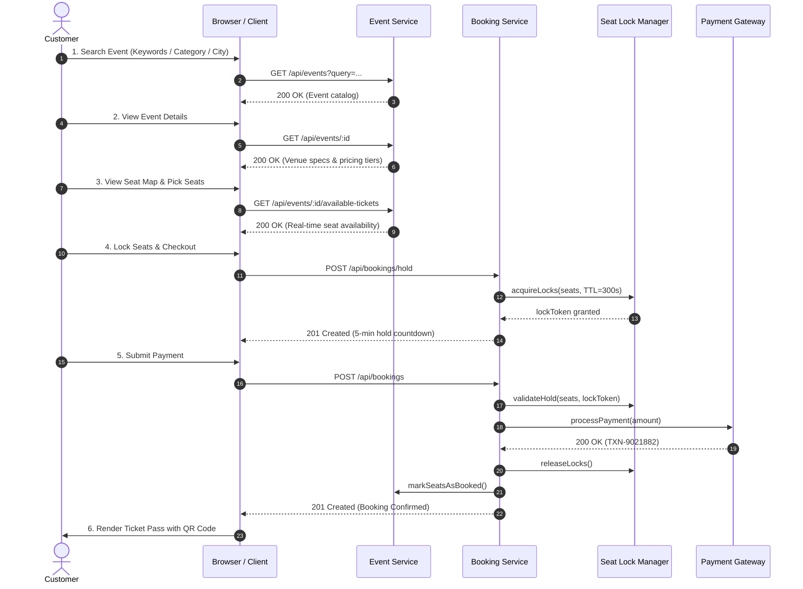

# Online Event Ticket Booking System — Low-Level Design (LLD)

**Round 2: Low-Level Design Challenge (30 Marks)**  
A full-stack Node.js / Express implementation of an online event ticket booking platform featuring concurrent seat reservation locks, payment simulation, ticket confirmation with QR codes, booking cancellation with seat recovery, and an interactive commercial web UI.

---

## 🚀 Quick Start

### 1. Install Dependencies
```bash
npm install
```

### 2. Start Application
```bash
npm start
```
The application will launch at: **`http://localhost:3000`**

### 3. Run Automated LLD Test Suite
```bash
npm test
```
Runs 10 automated test cases verifying all challenge tasks, concurrency conflict rejection (HTTP 409), and seat recovery after cancellation.

---

## 📐 Task Breakdown & LLD Specifications

### Tasks 1 & 2: REST API Catalog (Methods, URIs & Purposes)

| Task | HTTP Method | Endpoint URI | Purpose | Status Code |
| :--- | :--- | :--- | :--- | :--- |
| **Search Event** | `GET` | `/api/events` | Search event catalog by keyword, city, or category | `200 OK` |
| **Get Event Details** | `GET` | `/api/events/:eventId` | Retrieve full event details, venue specs, and ticket pricing tiers | `200 OK` / `404 Not Found` |
| **Get Available Tickets** | `GET` | `/api/events/:eventId/available-tickets` | Real-time seat inventory matrix with lock and availability status | `200 OK` / `404 Not Found` |
| **Hold Seats (Lock)** | `POST` | `/api/bookings/hold` | 5-minute atomic lock to prevent race conditions during checkout | `201 Created` / `409 Conflict` |
| **Book Ticket** | `POST` | `/api/bookings` | Validate lock, charge payment, issue confirmed booking | `201 Created` / `409 Conflict` / `402 Payment Required` |
| **Check Booking Status** | `GET` | `/api/bookings/:bookingId` | Retrieve booking status (`CONFIRMED`, `CANCELLED`) and ticket pass QR | `200 OK` / `404 Not Found` |
| **Cancel Ticket (Task 6)** | `POST` | `/api/bookings/:bookingId/cancel` | Cancel booking, release seats back to inventory, and process refund | `200 OK` / `400 Bad Request` / `404 Not Found` |

---

### Task 3: Request & Response Specification for "Book Ticket"

#### Endpoint: `POST /api/bookings`
**Request Payload:**
```json
{
  "eventId": "evt_music_fest_2026",
  "customer": {
    "name": "Sarah Connor",
    "email": "sarah.connor@example.com",
    "phone": "+1-555-0199"
  },
  "seatIds": ["seat_A1", "seat_A2"],
  "lockToken": "lock_9x3a1b_1770000000",
  "paymentDetails": {
    "method": "CREDIT_CARD",
    "simulateStatus": "SUCCESS"
  }
}
```

**Success Response (`201 Created`):**
```json
{
  "success": true,
  "statusCode": 201,
  "message": "Tickets successfully booked and confirmed",
  "data": {
    "bookingId": "bkg_7a8f9c12",
    "bookingReference": "EVT-89421",
    "status": "CONFIRMED",
    "eventId": "evt_music_fest_2026",
    "eventTitle": "Neon Symphony Live in Concert",
    "customer": {
      "name": "Sarah Connor",
      "email": "sarah.connor@example.com"
    },
    "seats": [
      { "id": "seat_A1", "seatNumber": "A1", "tier": "VIP", "price": 180 },
      { "id": "seat_A2", "seatNumber": "A2", "tier": "VIP", "price": 180 }
    ],
    "totalAmount": 360,
    "currency": "USD",
    "payment": {
      "paymentId": "pay_5d2b7810",
      "status": "SUCCESS",
      "transactionRef": "TXN-9021882"
    },
    "bookedAt": "2026-10-09T07:15:00.000Z",
    "qrCodeData": "TKT:EVT-89421|EVT:evt_music_fest_2026|SEATS:A1,A2"
  }
}
```

**Concurrency Conflict Response (`409 Conflict`):**
```json
{
  "success": false,
  "statusCode": 409,
  "error": "SEAT_ALREADY_RESERVED",
  "message": "Seat A1 is temporarily on hold by another customer.",
  "unavailableSeats": ["A1"]
}
```

---

### Task 4: HTTP Status Codes Matrix

| Code | Name | Rationale & Usage |
| :--- | :--- | :--- |
| **`200 OK`** | Success | Querying events, viewing event details, checking status, cancelling tickets. |
| **`201 Created`** | Created | Successfully creating a seat hold lock or issuing a confirmed booking. |
| **`400 Bad Request`** | Validation Error | Missing fields, empty seat selections, or attempting to cancel an already cancelled ticket. |
| **`402 Payment Required`** | Payment Failure | Payment gateway decline, card failure, or insufficient funds. |
| **`404 Not Found`** | Missing Resource | Non-existent event, seat, or booking ID. |
| **`409 Conflict`** | Concurrency Conflict | **Core LLD Guarantee:** Two users attempting to book or reserve the same seat simultaneously. |
| **`500 Server Error`** | Internal Error | Unhandled server or database exception. |

---

### Task 5: Customer Flow Sequence Diagram

Flow: **`Customer -> Search Event -> View Event -> Select Ticket -> Book -> Payment -> Confirmation`**



---

### Task 6: Additional API for Cancel Ticket

#### Endpoint: `POST /api/bookings/:bookingId/cancel`
```json
{
  "reason": "Change of schedule"
}
```

**Response (`200 OK`):**
```json
{
  "success": true,
  "statusCode": 200,
  "data": {
    "bookingId": "bkg_7a8f9c12",
    "bookingReference": "EVT-89421",
    "status": "CANCELLED",
    "refund": {
      "refundRef": "RFD-891024",
      "amount": 360,
      "status": "REFUNDED"
    },
    "freedSeats": ["A1", "A2"],
    "message": "Booking EVT-89421 cancelled. 2 seats released back to available inventory. Refund initiated."
  }
}
```

---

## 🏛️ System Architecture

```
d:\Samples\System_Design\
├── src/
│   ├── models/            # Event, Seat, Booking, Payment domain entities
│   ├── repositories/      # EventRepository, BookingRepository, SeatLockManager (TTL Lock)
│   ├── services/          # EventService, BookingService, PaymentService
│   ├── controllers/       # EventController, BookingController
│   └── routes/            # eventRoutes.js, bookingRoutes.js
├── public/                # Commercial web UI (HTML, CSS, JS)
│   ├── css/styles.css     # Design system (Stadium seat picker, passes, drawer)
│   ├── js/api.js          # REST client wrapper & latency tracker
│   ├── js/ticketBoxApp.js # Discovery, seat picker, checkout & wallet pass
│   └── js/lldDrawer.js    # Slide-over LLD specs & live REST API sandbox
├── test/
│   └── api.test.js        # Automated test suite (10/10 PASS)
├── server.js              # Express server
└── package.json
```
